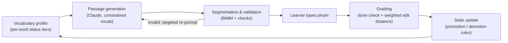

# Moxie

[](https://github.com/bytzhao/moxie/actions/workflows/ci.yml)

[](LICENSE)

**A typing game-inspired Chinese reading trainer that generates personalized and difficulty-callibrated practice passages, then grades you on every character.**

Learners who speak Mandarin well often can't *read* it at the same level. The bottleneck is decoding, or looking at a character and producing its sound, which Moxie targets directly. It tracks which of the ~11,000 words in the official HSK 3.0 vocabulary you know, has Claude write a short passage built almost entirely from those words plus a handful of "frontier" words you're still learning, and asks you to type the pinyin (romanized pronunciation, with tone numbers) for every character. Your answer is graded character by character and fed back into your vocabulary profile, which shapes the next passage.

> **Status:** Phase 1 proof of concept, in active development. The grading engine and learner model are built and tested. Next up are the API layer, Claude passage generation, and the frontend. See [Roadmap](#roadmap).

---

## How it works

Moxie runs a closed loop. Every passage both tests the learner and updates the model of what they know.



Claude is used for one thing only: writing the passage. Everything that decides what counts as correct, including segmentation, validation, answer-key generation, grading, and vocabulary state changes, is deterministic code. The model's output is also never trusted until it passes validation.

## Engineering highlights

**Validating LLM output instead of trusting it.** A passage is checked against the learner's known vocabulary before it is ever shown. Words outside the HSK list (hallucinations), words the learner hasn't encountered yet, and too few or too many frontier words each raise a distinct, structured error. Each error maps to a targeted correction prompt, and generation aborts after two failed repairs.

**Word segmentation without spaces.** Written Chinese has no word boundaries, and a vocabulary list alone can't resolve overlapping matches (中国人民 can be 中国 + 人民 or 中国人 + 民). Moxie uses a hand-written bidirectional maximum-matching (BiMM) segmenter over the HSK dictionary rather than an off-the-shelf library, so that segmentation and validation share one source of truth.

**Characters with more than one pronunciation.** Most ambiguous characters are resolved once they're segmented into a compound with a single reading. The residue (e.g. 了, 得, 长) is caught by a bounded table of polyphonic characters and escalated for disambiguation in context.

**Grading that tells a slip from a gap.** Tone errors are always severe. Beyond that, the grader distinguishes systematic phonological slips from real knowledge gaps:
- *Exact-match variants:* retroflex blur (zh/z, ch/c, sh/s), nasal confusion (n/ng) and ü typed as u are each generated as a candidate string and matched by equality.
- *Typos:* for syllables of four or more letters, a Levenshtein distance whose substitution cost is weighted by physical distance on a QWERTY keyboard. A normalized distance under a fixed threshold counts as a typo, not an error.

**An explicit learner state machine.** Each word sits in one of five tiers (Not Encountered → Learning → Familiar → Solid → Mastered). Promotion requires a streak of consecutive correct answers (3 / 3 / 5). Demotion floors soften as tier rises, since well-practiced words recover faster. Errors on a compound word propagate down to the specific character that was missed, but promotions don't propagate, because recognizing a character in one word isn't evidence of recognizing it elsewhere.

**Logging for future modeling.** Every graded word is written to an append-only appearance log. Encounter density is derived from that log with one aggregate query instead of being stored per word, which would mean rewriting ~11k rows every session. The log also accumulates the review history a fitted scheduler (e.g. half-life regression) will need in a later phase. The current scheduling constants are hand-set and named so they can be replaced.

## Design documentation

Moxie is specified before it is built. The [Product Requirements Document](docs/PRD_0.3.md) covers the data model, the generation and grading specifications, and the state-machine rules. Its **Decision Log** (§XIX) records each major design choice together with the evidence that would justify revisiting it.

## Stack

| Layer | Choice |
|---|---|
| Backend | Python 3.14, FastAPI |
| Database | SQLite via SQLAlchemy 2.0 ORM |
| LLM | Claude Sonnet (passage generation only) |
| Frontend | Vanilla HTML / CSS / JavaScript (deliberately framework-free in Phase 1) |
| Tooling | pytest, ruff, GitHub Actions |

## Repository layout

```
backend/
  segmenter.py     BiMM segmentation, passage validation, pinyin answer key
  levenshtein.py   per-character grading: tone check, variant matching, weighted edit distance
  csm.py           learner state machine: promotions, demotions, compound→character mirroring
  grading.py       grading orchestrator: input checks → levenshtein → csm → appearance log
  models.py        SQLAlchemy ORM models
  schemas.py       shared dataclasses and enums
  generation.py    (planned) recency scoring + Claude generation loop
  llm.py           (planned) Claude API wrapper
  main.py          (planned) FastAPI routes
data/
  hsk30.txt        HSK 3.0 vocabulary (static, generated by prepare_hsk30.py)
  polychars.txt    polyphonic character table
  db.py, seed.py   database connection and one-time seeding / baseline calibration
docs/              PRD, roadmap, earlier concept docs
tests/             pytest suites for segmenter, levenshtein, csm, grading
frontend/          (planned) landing, decoding, and results pages
```

## Running locally

Requires Python 3.14.

```bash
git clone https://github.com/bytzhao/moxie.git
cd moxie
python -m venv .venv && source .venv/bin/activate
pip install -r requirements.txt

cp .env.example .env        # then fill in the values
python -m data.seed         # creates data/moxie.db and calibrates the vocabulary profile

pytest                      # run the test suite
ruff check . && ruff format --check .
```

The web app itself isn't runnable yet; see the roadmap.

## Roadmap

- [x] HSK 3.0 dataset preparation and database seeding
- [x] Segmentation, validation, and answer-key pipeline
- [x] Grading engine and learner state machine
- [ ] **Milestone 0:** API routes wiring grading end to end (no LLM)
- [ ] **Milestone 1:** recency-scored word selection and Claude passage generation
- [ ] **Milestone 2:** decoding UI with live cursor, results page

Detailed task breakdown: [docs/ROADMAP.md](docs/ROADMAP.md).

## AI usage

This is a learning project as much as a product. I use Claude Code under a written contract ([CLAUDE.md](CLAUDE.md)). In general, Claude employs a Socratic teaching method and never writes into files without explicit and bounded permission. More specifically, Claude handles design discussion, code review, configuration and boilerplate, and drafted parts of this documentation. However, the core logic is written by hand: segmentation, grading, the state machine, the schema, and the tests. That includes every expected value the tests assert against, which I trace by hand through the algorithm rather than generate. With the exception of Section XIX, a laundry list of decisions, each PRD iteration is almost written by me, minus Claude passes for consistency and minute edits.

## Acknowledgments

- HSK 3.0 vocabulary data adapted from [ivankra/hsk30](https://github.com/ivankra/hsk30) (MIT).
<!-- TODO: credit source of data/polychars.txt -->

## License

[MIT](LICENSE)
